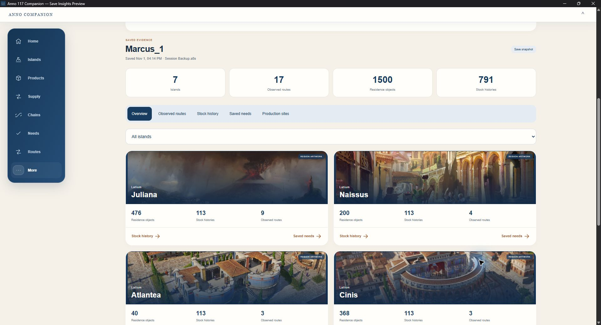
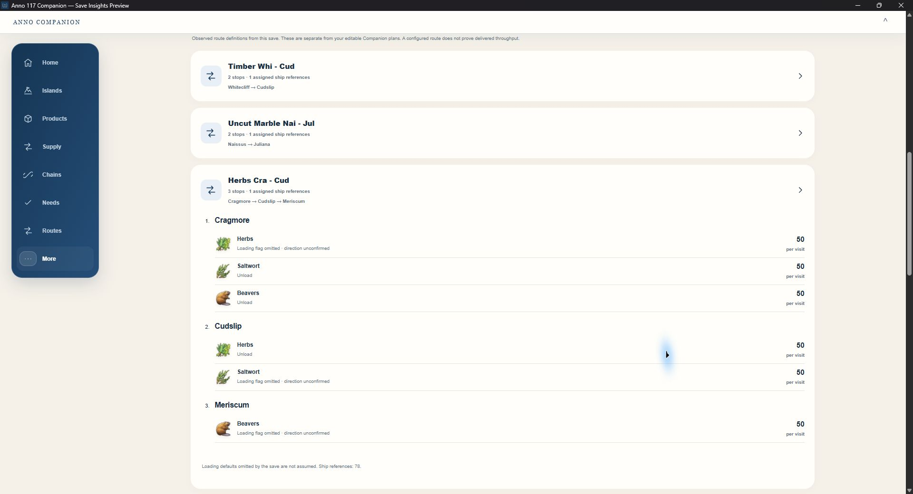
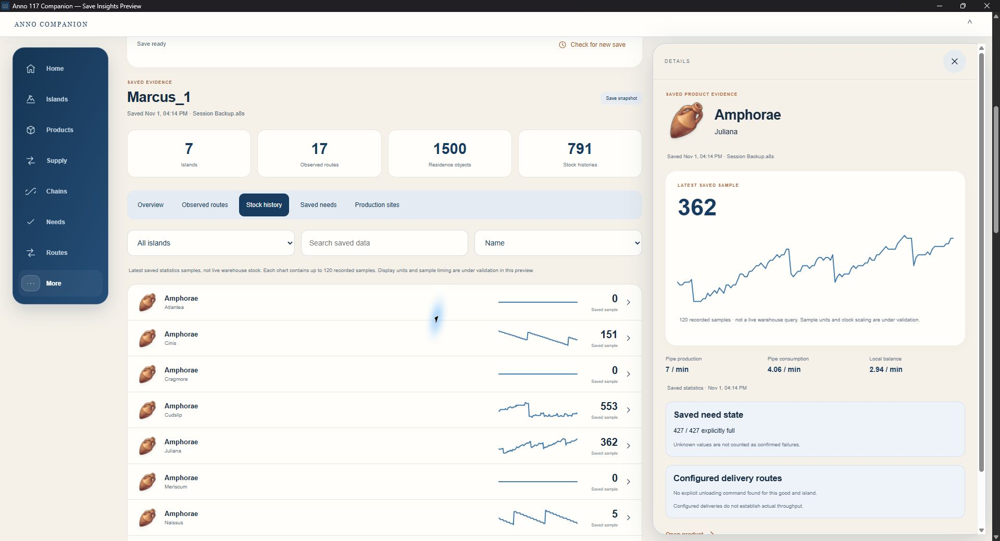

# Save Insights — working preview

**Development update — 2 November 2026**

The Companion now has a working local save-game reader alongside the live production pipe. This is already running in a private development build; it is not included in the current public release yet.

## How it works

- Switch **Use save data ON/OFF** inside the Companion.
- With save data enabled, the dashboard can use recorded production and consumption even when the pipe is unavailable. Fresh pipe data takes priority when it belongs to the same campaign and island.
- Choose a campaign, follow its newest save automatically, or select a specific save.
- Read additional information from the save: recorded stock history, existing in-game trade routes and their goods/stops, residence need states and production buildings.
- Save parsing happens locally on the Windows PC. Save files are read without modification and are not uploaded. Paired devices use the PC Companion to view the data.

Save statistics are snapshots and may predate the save itself; they are not a substitute for current live telemetry. The interface identifies saved data separately from fresh pipe data.

## Screenshots from the working Windows preview

These are actual captures of the Windows Companion development build using my own saved campaign, not mockups or synthetic demo data. Pairing details are collapsed. The screenshots show recorded save data; they do not claim a currently connected live game. The interface is still being refined before release.

### Saved empire overview

Seven islands, 17 observed route definitions, 1,500 residence objects and 791 stock histories read from this save. Island illustrations are region artwork, not images extracted from the save.

### Existing in-game routes

A three-stop route with multiple goods and saved cargo commands. Omitted loading flags are marked as unconfirmed; a configured route does not prove delivered throughput.

### Stock history and saved needs

Amphorae on Juliana: 120 recorded stock samples, a detail chart and explicitly fulfilled need states from the save. These are historical statistics, not a live warehouse query. Production figures in this capture are cached/saved statistics, not fresh pipe readings; the preview still uses “Pipe production/consumption” labels in this detail panel.

## Planned release

I'm planning to release this on **Thursday, 5 November 2026, after the 3.0 patch**, once I have checked the reader against the updated game and its saves. The reader already works with the current game; compatibility with 3.0 still needs that final check.

**The entire Companion, including Save Insights and the existing pipe features, is free.**

[Back to ideas](README.md) · [Companion downloads and setup](../README.md)
