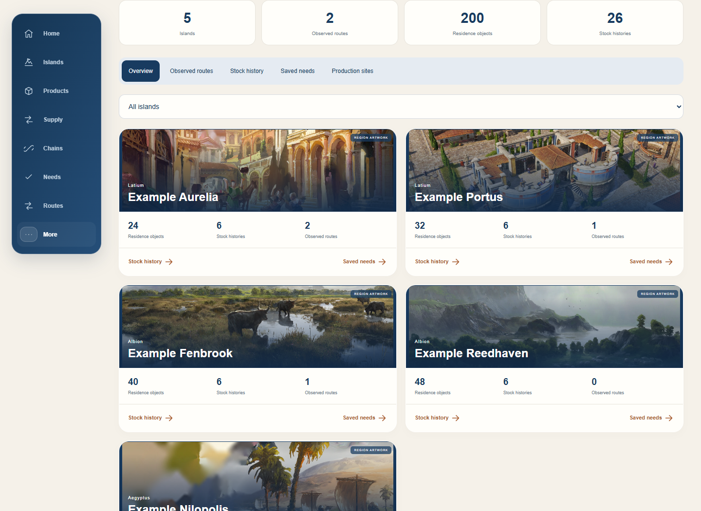

# Save Insights

Save Insights is available for free in Companion **0.21.0**. Open **More → Save Insights** on Windows, choose a campaign, then turn **Use save data** on. You can follow the latest save automatically or select a specific save. Paired Android and browser clients use the Windows Companion to access the results.

- The Windows app reads save files locally without changing or uploading them.
- Fresh production pipe data takes priority for matching islands in the same campaign. The save supplies recorded statistics when fresh pipe data is unavailable, including while the game is paused.
- Explore historical stock samples, existing trade routes, residence needs and production buildings. Configured routes do not prove deliveries; saved stock samples are historical.
- Building plans show applicable specialists found in your save and distinguish stored and assigned copies. The catalogue includes fertility effects from Prophecies of Ash. Import plans can suggest stored captains with relevant ship effects and list applicable classes when available.

Tested with game 3.0, including an Aegyptus island in a matching live pipe session and save. Captain handling was verified with test data; the tested game save did not expose a confirmed captain.

## Screenshot

Actual Companion dashboard with synthetic example data:

[Back to ideas](README.md) · [Downloads and setup](../README.md)
