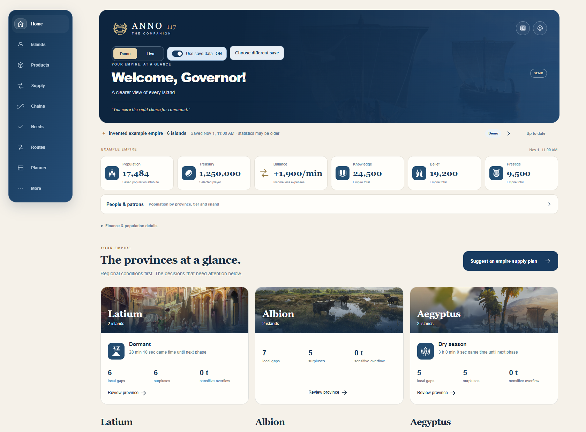
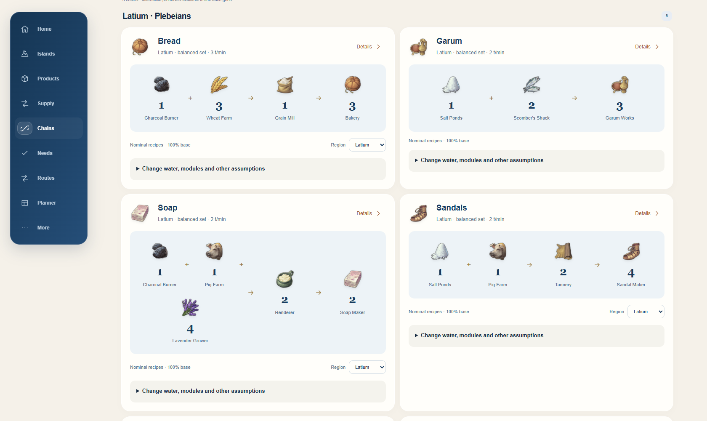

# Anno 117 Companion

**Dein Imperium. Klarer im Blick.**

Produktion, Versorgung und Planung für **Anno 117: Pax Romana**. 
Ein kostenloser, inoffizieller Companion von Ádám. Windows-App · Android-App · Browser auf iPhone & PC.

**[Für Windows herunterladen](https://github.com/oriskoat/anno117companion/releases/download/v0.28.0/Anno117Companion-0.28.0-Windows-x64.zip)** &nbsp; · &nbsp; **[Für Android herunterladen](https://github.com/oriskoat/anno117companion/releases/download/v0.28.0/Anno-Companion-0.28.0.apk)**

[Einrichtung](docs/SETUP.de.md) · [Neueste Version](https://github.com/oriskoat/anno117companion/releases/latest) · [English](README.md) · [☕ Spendier mir einen Kaffee](https://revolut.me/vafvyop?currency=EUR&amount=500)

*Tatsächliche Browseroberfläche mit erfundenen Demo-Daten. Zum Ausprobieren der Demo ist keine Spielverbindung nötig.*

## Was braucht dein Imperium?

| Deine Frage | Die passende Übersicht |
| --- | --- |
| **Wo fehlt etwas?** | Produktion, Verbrauch und lokale Bilanzen nach Insel oder Ware, mit Versorgungsvorschlägen zwischen Inseln. |
| **Was soll ich bauen?** | Ausgeglichene Ketten nach Region, Bevölkerungsstufe, Ware und DLC. Wasser, Module, Getreidespeicher, Götterboni und passende Spezialisten als Szenario ausprobieren. |
| **Wie versorge ich eine ganze Provinz?** | Produktion und Importe über mehrere Inseln planen, einschließlich Vorprodukten, Brennstoff und saisonalen Reserven. Gebäudezahl, Arbeitskräfte, Unterhalt und Lagerbedarf vergleichen. |
| **Was liefert mein Spielstand?** | Aufgezeichnete Bestände, Bevölkerung, Bedürfnisse, Schutzgötter, Genehmigungen, Forschung, Routen und Spezialistenzuweisungen, soweit vorhanden. |
| **Wie transportiere ich die Waren?** | Gemeinsam gespeicherte Routenpläne mit mehreren Waren und Stopps, Frachtprüfungen, angenommener Flottenbedarf und optionale beobachtete Zeitspannen für Rundfahrten. |
| **Wie behalte ich unterwegs den Überblick?** | Dieselbe Oberfläche im lokalen Netzwerk, ein Android-Widget und ein illustrierter [Empire-Summary-PDF-Bericht](docs/Example-Empire-Summary.pdf). |

**Latium · Albion · Aegyptus** — Katalog für Spielupdate 3.0, 12 Oberflächensprachen, Demo/Live und lokale Save Insights. Alle Funktionen sind kostenlos.

<strong>Ausgeglichene Produktionsketten ansehen</strong>

Dies sind Katalogszenarien. Aufgezeichnete Produktion und geplante Boni bleiben getrennt.

[Weitere Bilder](docs/SCREENSHOTS.md) · [Neu in 0.28.0, Englisch](docs/RELEASE_NOTES_028.md) · [Planungsanleitung, Englisch](docs/RELEASE_028.md)

## Loslegen

1. **Windows-ZIP herunterladen**, in einen beschreibbaren Ordner wie Dokumente entpacken und **Anno117Companion.exe** starten. Python oder Entwicklungswerkzeuge sind nicht nötig. Zum Kennenlernen **Demo** auswählen.
2. **Spielstand verwenden:** **Live** wählen, **Use save data** aktivieren und die Kampagne auswählen. Die Analyse erfolgt lokal; zum Ansehen eines gespeicherten Stands muss das Spiel nicht laufen.
3. **Live-Statistiken ergänzen:** `/pipe` zu Annos Startargumenten in Steam oder Ubisoft Connect hinzufügen, das Spiel neu starten, einen Spielstand laden, die Zeit laufen lassen und die **Produktionsstatistik** öffnen.
4. **Weiteres Gerät verbinden:** Windows Companion laufen lassen. Im selben LAN/WLAN den QR-Code scannen oder die angezeigte PC-Adresse und den sechsstelligen Kopplungscode eingeben. Ein Windows-Passwort ist nicht nötig.

**Spiel pausiert?** Während der Pause kommen keine neuen Pipe-Statistiken. Der Companion behält die letzten passenden Daten und zeigt deren Alter. Live bedeutet nicht, dass in jedem Moment eine neue Nachricht eintrifft.

| Gerät | Verwendung |
| --- | --- |
| **Windows 10/11 x64** | Vollständiges Companion-Fenster oder **Open browser**. Die Windows-App stellt den lokalen Server bereit. |
| **Android 8.0+** | APK installieren, mit dem PC koppeln und optional das Startbildschirm-Widget hinzufügen. |
| **iPhone / iPad** | PC-QR-Link in Safari öffnen; über **Teilen → Zum Home-Bildschirm** ein Symbol hinzufügen. Keine native iOS-App erforderlich. |
| **Weiterer Computer** | PC-Adresse im Browser öffnen und koppeln. Keine zweite Spielinstallation nötig. |

**Bereits installiert?** Unter **More → Updates** auf Windows oder Android aktualisieren. Die APK behält ihre öffentliche Signaturidentität. Die Windows-EXE ist derzeit nicht digital signiert.

[Ausführliche Einrichtung & Fehlerbehebung](docs/SETUP.de.md) · [Windows-Kompatibilität, Englisch](docs/WINDOWS_COMPATIBILITY.md) · [Selbst bauen, Englisch](docs/BUILD.md)

## Poster der Produktionsketten

Zum Nachschlagen oder Drucken in voller Auflösung herunterladen:

| Latium | Albion | Aegyptus |
| :---: | :---: | :---: |
| **[A2-Poster](.posters/latium-production-a2.png)** | **[A2-Poster](.posters/albion-production-a2.png)** | **[A2-Poster](.posters/aegyptus-production-a2.png)** |

[Aegyptus-Kurzübersicht in A4](.posters/aegyptus-chain-poster-a4.png)

## Gut zu wissen

Der Companion **liest Daten und hilft beim Planen**. Er steuert das Spiel nicht und erstellt keine Routen im Spiel. Ein lokales Produktionsdefizit kann bereits durch deine Schiffe ausgeglichen sein. Gespeicherte Informationen, manuelle Beobachtungen und geplante Änderungen bleiben getrennt. Unbekannte Abdeckung, Voraussetzungen und hypothetische Bauplätze bleiben bedingt; die Versorgungsplanung ist ein konservatives Szenario, kein garantiertes globales Optimum.

Für gekoppelte Geräte muss die Windows-App weiterlaufen. Spielstände und Spieldaten bleiben lokal. Kein Pflichtkonto, kein Abo und keine Werbung. [Datenschutz, Englisch](PRIVACY.md)

## Von einem Mitspieler

Ich bin **Ádám**, ein Spieler aus Ungarn. Ich habe den Companion gebaut, um mehr Zeit mit meinem Imperium und weniger Zeit in Statistikmenüs zu verbringen.

Wenn er dir hilft, **[spendier mir einen Kaffee](https://revolut.me/vafvyop?currency=EUR&amount=500)**. Unterstützung ist vollkommen freiwillig. **Kein Tribut erforderlich. Viel Freude mit deinem Imperium!**

Meine nächste Idee: eine [von Albion inspirierte pannonische Region](.ideas/README.md). Ein Konzept, noch keine veröffentlichte Mod.

---

[Windows-Changelog](CHANGELOG_WINDOWS.md) · [Android-Changelog](CHANGELOG_ANDROID.md) · [Fehler melden](https://github.com/oriskoat/anno117companion/issues)

Inoffizielles Community-Projekt ohne Verbindung zu oder Unterstützung durch Ubisoft. Der ursprüngliche Anwendungscode steht unter [MIT-Lizenz](LICENSE). Ubisoft-Grafiken, Spieltexte und abgeleitete Ressourcen behalten ihre Rechte und werden nicht unter MIT neu lizenziert. [Grafiken und Rechte](ASSET_RIGHTS.md) · [Drittanbieter-Hinweise](THIRD_PARTY_NOTICES.md)
