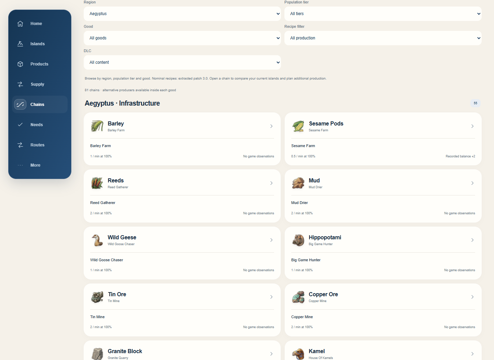
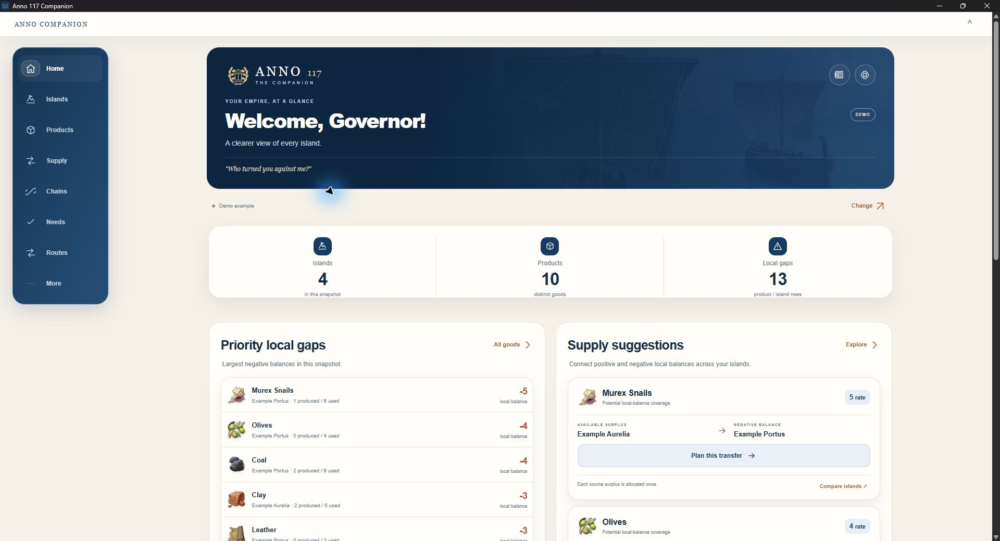
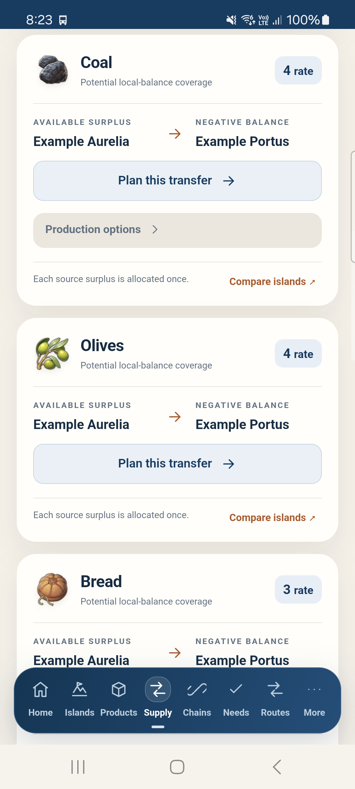
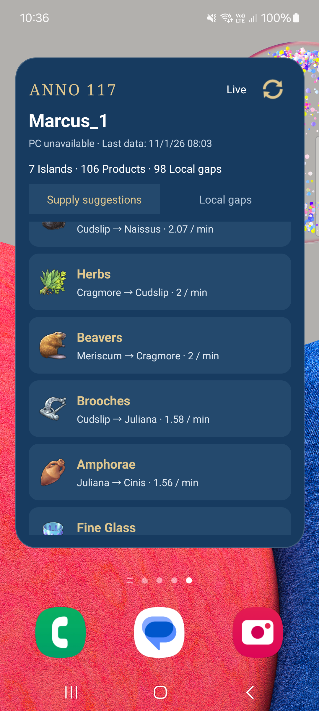

# Anno 117 Companion

**English** · [Deutsch](README.de.md)

**Your empire. A clearer view.** A free, unofficial companion for Anno 117: Pax Romana by Ádám.

[Download Windows ZIP](https://github.com/oriskoat/anno117companion/releases/download/v0.21.5/Anno117Companion-0.21.5-Windows-x64.zip) · [Download Android APK](https://github.com/oriskoat/anno117companion/releases/download/v0.21.5/Anno-Companion-0.21.5.apk) · [All downloads](https://github.com/oriskoat/anno117companion/releases/latest)

## Production chain posters

Full-resolution PNGs for download or print:

**[Latium (A2)](.posters/latium-production-a2.png) · [Albion (A2)](.posters/albion-production-a2.png) · [Aegyptus (A2)](.posters/aegyptus-production-a2.png)**

[Aegyptus · A4 quick reference](.posters/aegyptus-chain-poster-a4.png)

☕ **[Buy me a coffee](https://revolut.me/vafvyop?currency=EUR&amount=500)** — the Companion is free. Support is completely optional. No tribute required.

[Windows changelog](CHANGELOG_WINDOWS.md) · [Android changelog](CHANGELOG_ANDROID.md)

Windows first, then any device on your local network. The Windows app reads the game’s production pipe and provides the same dashboard in its own window, on Android, or in a browser on iPhone/another computer.

**New in 0.21.1:** Each Needs card can be collapsed independently. The closed card shows the good or service and its fulfilment status.

Open **More → FAQ / How To** in the app for setup, pairing, troubleshooting and planning help.

## New in 0.21.0: Aegyptus and Save Insights

**Aegyptus / Dawn of the Delta** adds Threshers, the Potters–Chanters and Scribes–Gymnasiarchs paths, and 81 regional chain entries. The catalogue also refreshes Latium and Albion for game update 3.0. Use **Chains → Region** or the DLC filter, and choose a destination island to see local production and import options.

**Save Insights is free.** On Windows, open **More → Save Insights**, choose your campaign and turn **Use save data** on. The Companion reads your save locally and keeps fresh pipe statistics first when they match the campaign. Paired devices can see saved routes, stock history, residence needs, and specialists relevant to building or import plans.

Already using the Companion? Open **More → Updates** on Windows or Android to get the latest release through the built-in updater.

[How Save Insights works](.ideas/save-insights.md)

## Screenshots

**Windows Companion — actual EXE window:**

**Actual Android APK and home-screen widget on Samsung:**

| Supply in the app | Home-screen widget |
| --- | --- |
|  |  |

[View all 16 screenshots](docs/SCREENSHOTS.md): Windows Supply, chain calculator and Needs; browser route plans and regional import; Android product details; illustrated PDF.

[Open the actual example Empire Summary PDF](docs/Example-Empire-Summary.pdf).

## What it does

- Home, Islands and Products: received production, consumption, local balances, productivity, buildings, workforce, economy fields and technical data.
- Supply suggestions and shared multi-good/multi-stop Trade Route plans. Review transfers one by one; record cargo quantities and check cyclic cargo capacity.
- Production chains by region, tier, good and DLC, with balanced building sets, productivity choices and relevant specialists.
- Region-aware production suggestions: build locally where possible, or choose a suitable island in the producing region and plan import to the original destination.
- Needs by island/tier/category, nominal per-residence rewards, manual fulfilment observations and building area effects.
- Illustrated Empire Summary PDF. On Home, find the small newspaper icon beside Settings.
- Resizable Android widget with scrollable Supply / Local gaps, product icons, Demo/Live, refresh and links into the app.
- Twelve interface languages, official game terminology/dialogue and region artwork.
- Cached data stays visible when the game stops sending statistics. Every source keeps its age/status.

## Start on Windows

### 1. Download and open the Companion

1. **[Download the Windows ZIP directly](https://github.com/oriskoat/anno117companion/releases/download/v0.21.5/Anno117Companion-0.21.5-Windows-x64.zip)**, or choose the Windows ZIP on the [latest release page](https://github.com/oriskoat/anno117companion/releases/latest). GitHub's **Code → Download ZIP** is the source code, not the ready-to-run app.
2. Right-click the downloaded ZIP and select **Extract All**. Choose a folder you can write to, for example `Documents\Anno117Companion`. Run the extracted app, rather than opening the EXE inside the ZIP.
3. Open **Anno117Companion.exe**. Python, Android Studio and development tools are not needed.
4. Choose **Demo** to explore the invented Example Empire without starting the game. The top bar contains the local-server controls, Demo/Live switch and pairing details for other devices. Expand the bar if it is collapsed.
5. For your own game, follow the `/pipe` instructions below, then select **Live**. Keep one Companion instance running on the gaming PC.

Target: Windows 10 22H2 / Windows 11 **x64**. The embedded window uses .NET Framework 4.8+ and WebView2 109+. If these are missing, the bundled browser-mode controller offers **Open browser** so you can use the dashboard in your installed browser. No prerequisite is silently installed. The EXE is unsigned; Windows reputation/security controls may display a warning. No clean Windows VM certification is claimed. [Compatibility details](docs/WINDOWS_COMPATIBILITY.md).

### 2. Enable the game's statistics pipe

**The launch argument is `/pipe` — including the forward slash.** Enter it in the game's launcher settings, not in the Companion, an in-game chat or a console. The game must be restarted after adding it. Ubisoft documents pipe activation in its [Anno 117 pipe example](https://github.com/UbisoftMainzAnno/anno117_pipe_example#activation).

**Ubisoft Connect**

1. Close Anno 117 if it is running.
2. Open your Ubisoft Connect library and find **Anno 117: Pax Romana**.
3. Open the game's menu/settings and choose **Properties**. Depending on your launcher version, this is available from the game's menu, a right-click, or **Manage**.
4. Find **Game launch arguments / Add launch arguments**, add `/pipe` and save. If you already use other arguments, retain them and append a space followed by `/pipe`.
5. Launch Anno again from that launcher.

**Steam**

1. Close Anno 117. In your Steam Library, right-click the game and open **Properties → General**.
2. Add `/pipe` to **Launch Options**, retaining any existing arguments, then close Properties and launch the game again. See [Steam's launch-option instructions](https://help.steampowered.com/en/faqs/view/7D01-D2DD-D75E-2955).
3. If your Steam installation starts through Ubisoft Connect and no statistics arrive, check the Anno launch arguments in Ubisoft Connect as well.

### 3. Receive your first Live statistics

**The game only supplies new statistics while the simulation is running — not while paused.** Let the game run and receive statistics at least once. If you pause afterwards, the Companion continues to display the **last received data**, including its supply calculations, and marks older values as **Cached** with their age. It does not invent or extrapolate changes during the pause. When you resume and the game publishes statistics again, the values update automatically. If no data has been received yet, pausing cannot provide an initial snapshot.

1. Keep the Companion's **local server running** and select **Live**.
2. In Anno, load a save and **resume the simulation**.
3. Open **Production Statistics** using the game's statistics interface. Allow a little time for island statistics to arrive; islands can update separately.
4. Check the Companion's status. **Live + cached** means some islands have fresh data while others still use their previous values. Individual islands retain their own update age.
5. When you pause, leave the statistics view, or close the game, the pipe may stop publishing. The last data remains available as **Cached**, with its age. Live mode means “use my game connection”; it does not guarantee that a new message is arriving at that moment.

You can use the complete tool in the EXE, or click **Open browser**. The Windows app must stay running to serve other devices. Minimizing it is fine; closing it stops its server.

## Android, iPhone and another computer

### Before pairing

- Start the Windows Companion and leave its local server running. Expand the pairing bar to see the **PC address**, **six-digit code** and **QR code**.
- Connect your phone/tablet/laptop and the PC to the same trusted local network. The PC may use Ethernet while the phone uses Wi-Fi.
- Use the address displayed by the Companion, including its port, for example `http://192.168.1.50:11780`. This is only an example: use **your PC's displayed address**, not this one or `localhost` on the phone. The six-digit code alone cannot find the PC.
- If Windows Firewall prompts, allow the Companion on your trusted **Private** network. Guest Wi-Fi/client isolation or a VPN may prevent devices from reaching one another.

### Android app

1. **[Download the Android APK directly](https://github.com/oriskoat/anno117companion/releases/download/v0.21.5/Anno-Companion-0.21.5.apk)** on your phone and open the downloaded file.
2. If Android requests permission to install from that browser/file manager, review and allow that installation source to proceed. This is a direct APK installation, not a Play Store download.
3. Open **Anno Companion**. Demo works without pairing or the game.
4. Select **Live**. If the app is not paired, it opens the connection screen. Enter the PC address displayed by the Windows app and its current six-digit code, then connect.
5. Pairing is remembered. If a code has expired, use the current code from the PC window. You do not need your Windows username, Windows password or SMB access.
6. For the widget, use **More → Add home screen widget**, then confirm placement in your launcher; alternatively use the launcher's Widgets menu. The widget has its own Demo/Live control. Background refresh timing depends on Android; use its refresh button when needed.

Requires Android **8.0+**. The public app ID is `hu.anno117.companion`. Older Pipe Probe/development builds use a different ID and remain separate; pair the public app once. Public APK updates retain the package and dedicated signing identity. The private key is not in this repository.

### iPhone / iPad

1. Scan the Windows Companion's QR code with your camera and open the link in Safari. Alternatively, type the displayed PC address into Safari and enter the six-digit pairing code when asked.
2. Select **Live** for your own statistics, or **Demo** for the example empire.
3. To keep an icon, use Safari's **Share → Add to Home Screen**. Menu wording may differ by iOS version.
4. Keep the PC Companion running and remain on the same LAN. There is no native iOS app; this is the Companion's local web interface.

### Another computer

Open the displayed PC address in a browser on that computer, enter the six-digit code, and select Demo or Live. No second bridge or game installation is needed on the viewing computer.

## If something does not connect

| What you see | What to check |
| --- | --- |
| Live selected, but Cached data | Resume the game; confirm `/pipe` was added before the last game launch; close and reopen Production Statistics. Check each island's age. |
| Live + cached | Fresh messages are arriving for some islands. Others keep their last values until the game publishes them again. |
| Waiting for Anno / no islands | Load a save and open Production Statistics. Start only one pipe-reading tool at a time: another Companion or pipe reader can occupy the game's pipe. |
| Phone cannot reach the PC | Keep the Windows server running. Check the displayed IP/port, shared LAN, Private-network firewall permission, guest-network isolation and VPN. |
| Pairing code rejected | Use the current six-digit code from the PC. It expires/rotates; it is not your Windows PIN or password. After repeated failures, wait a minute before retrying. |
| Embedded Windows window unavailable | Use the offered **Open browser** controller. For an explicit browser-mode launch, run `Anno117Companion.exe --browser` in the extracted app folder. |
| Cannot start a second Companion | Close the previous instance. The local server port may already be in use. |

For a bug report, describe the platform, Companion version, visible connection state and reproduction steps. Do not upload `bridge-settings`, pairing codes, QR codes, tokens or personal exports.

## What the numbers mean

The game pipe reports production statistics, not warehouse stock, imports, ships or actual residence/service coverage. A local negative balance may already be covered by trade. Suggestions and routes are plans: apply them manually in Anno. The app never sends game commands.

Nominal catalogue data originates from extracted patch 2.0 resources. Difficulty affects manual residence-demand scenarios, not the already-observed consumption rates or factory recipe ratios. Residence counts, fertility, deposits, unlocks and active DLC ownership are checked in game. Manual need confirmations are stored on the current client; shared route plans are stored on the PC bridge. Rate-to-minute conversion/catalogue coverage and authored translations retain verification limits. The demo is synthetic, using invented Example islands.

## Updates and saved data

Update checks use GitHub Releases. Downloads are verified; Windows restarts to replace the EXE, and Android uses the system installer. Drafts/prereleases are not selected by the current stable updater. Keep `bridge-settings` beside the Windows EXE when replacing it; it contains private pairing, shared route plans and cache. Do not upload that folder or exported PDFs in a bug report.

## Build and test

Windows: Python **3.11 x64** with Tk, then `pip install -r requirements-build.txt` and `.\build_release.ps1 -Version 0.21.5`. The build includes a native-DLL payload audit. Generated dashboard/catalogue resources are checked in; no local game extraction is required to build this snapshot.

Android: JDK 17, Android SDK platform 35 and the Gradle wrapper. Set your own untracked `android-probe/local.properties`, then run `gradlew.bat assembleDebug lintDebug` there. A public release build requires private signing environment variables `ANNO_KEYSTORE`, `ANNO_STORE_PASSWORD`, `ANNO_KEY_ALIAS`, `ANNO_KEY_PASSWORD`; run `assembleRelease lintRelease`. Debug builds use the `.dev` package suffix. Never commit keys or passwords.

Checks: `python -m unittest test_bridge test_trade_routes test_updater test_public test_startup test_report`; with Node 22, `npm ci` then `npm test`.

A source build can be made with your own Android key. It cannot replace official release-signed installs unless the signing identity matches; build output need not be byte-identical across environments.

## Pannonia — another idea

My next idea is an **Albion-inspired Pannonian region for Anno 117**. It now has its own [Pannonia concept folder](.ideas/README.md) in this repository. The detailed design covers two population paths, orchards and basket weaving, horse breeding, civic Marvels and the Ripa Pannonica frontier network. It is separate from the Companion; no playable mod or release date is announced.

## About, support and ownership

Made by Ádám, a gamer from Hungary. Free to use; no account, advertisements or mandatory payment.

[Buy me a coffee](https://revolut.me/vafvyop?currency=EUR&amount=500) — optional. No tribute required. The Empire is yours to enjoy.

This is an unofficial community project, not affiliated with or endorsed by Ubisoft. Original application code is MIT-licensed. Anno 117 artwork, official game text/dialogue and game-derived resources remain Ubisoft materials and are **not** relicensed under MIT. Third-party software retains its own licenses. See LICENSE, ASSET_RIGHTS.md, THIRD_PARTY_NOTICES.md and third-party/.

[Privacy](PRIVACY.md). No analytics, advertising SDK or game-data upload. GitHub handles update traffic; Revolut handles optional support. The local HTTP transport is unencrypted and intended for a trusted LAN.
