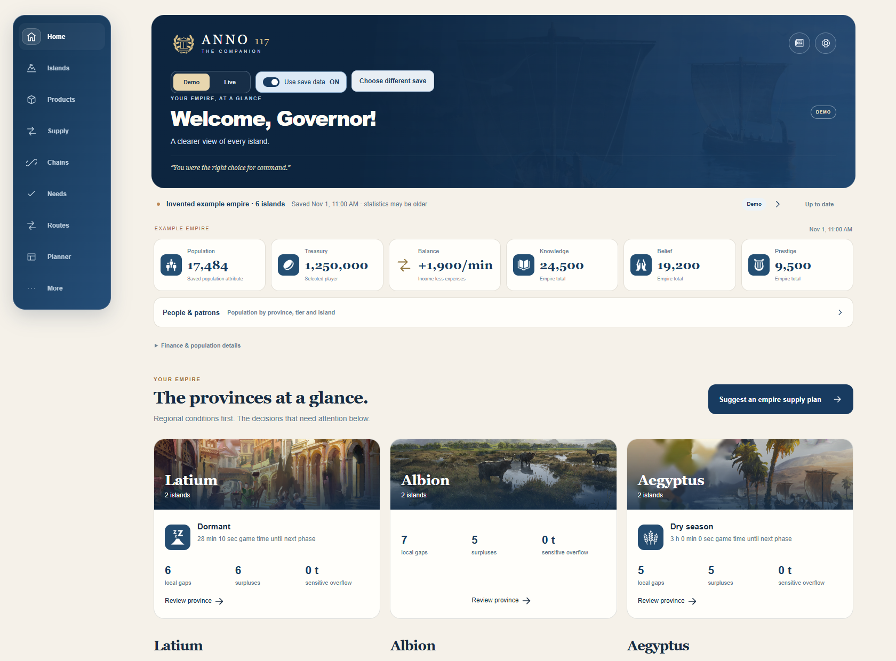
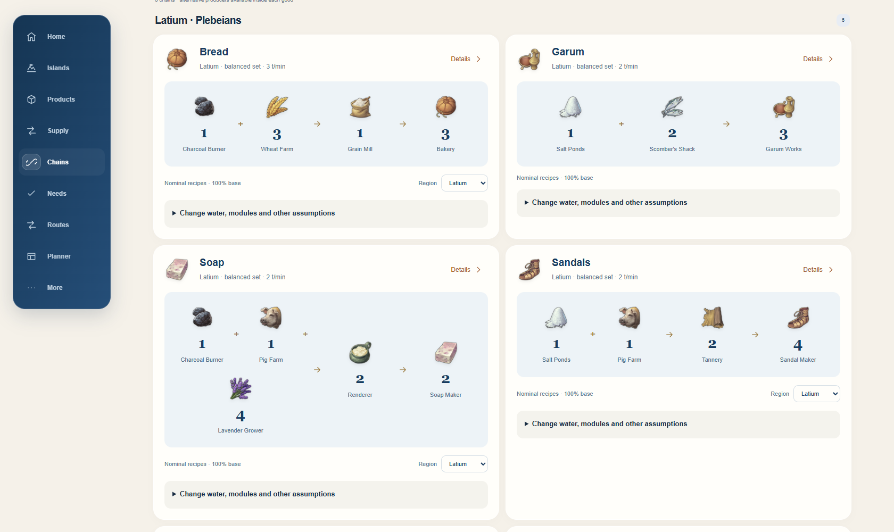

# Anno 117 Companion

**Your empire. A clearer view.**

Production, supply and planning for **Anno 117: Pax Romana**. 
A free, unofficial companion by Ádám. Windows app · Android app · iPhone & desktop browser.

**[Download for Windows](https://github.com/oriskoat/anno117companion/releases/download/v0.28.0/Anno117Companion-0.28.0-Windows-x64.zip)** &nbsp; · &nbsp; **[Download for Android](https://github.com/oriskoat/anno117companion/releases/download/v0.28.0/Anno-Companion-0.28.0.apk)**

[Setup guide](docs/SETUP.md) · [Latest release](https://github.com/oriskoat/anno117companion/releases/latest) · [Deutsch](README.de.md) · [☕ Buy me a coffee](https://revolut.me/vafvyop?currency=EUR&amount=500)

*Actual browser dashboard with fictional Demo data. No game connection is needed to explore Demo.*

## See what your empire needs

| Start with a question | Find the answer |
| --- | --- |
| **Where am I short?** | Production, consumption and local balances by island or good, with supply suggestions between islands. |
| **What should I build?** | Balanced chains by region, population tier, good and DLC. Try water, modules, granaries, deity bonuses and relevant specialists. |
| **Can I supply a whole province?** | Plan production and imports across islands, including upstream ingredients, fuel and seasonal reserves. Compare buildings, workforce, upkeep and storage objectives. |
| **What can I use from my save?** | Recorded stocks, population, needs, patrons, permits, research, routes and specialist assignments, where available. |
| **How will I move the goods?** | Shared multi-good, multi-stop route plans, cargo checks, assumed fleet requirements and optional bounded cycle observations. |
| **Can I keep an overview elsewhere?** | The same dashboard on your local network, an Android home-screen widget and an illustrated [Empire Summary PDF](docs/Example-Empire-Summary.pdf). |

**Latium · Albion · Aegyptus** — game update 3.0 catalogue, 12 interface languages, Demo/Live and local Save Insights. Everything is free.

<strong>See the balanced production chains</strong>

These are catalogue scenarios. Recorded production and proposed bonuses remain separate.

[More screenshots](docs/SCREENSHOTS.md) · [What's new in 0.28.0](docs/RELEASE_NOTES_028.md) · [Planner guide](docs/RELEASE_028.md)

## Get started

1. **Download the Windows ZIP**, extract it to a writable folder such as Documents, and run **Anno117Companion.exe**. No Python or development tools required. Choose **Demo** to look around.
2. **Use your save:** select **Live**, turn **Use save data** on and choose your campaign. Save analysis happens locally; the game does not need to be running to review a saved snapshot.
3. **Add live statistics:** put `/pipe` in Anno's Steam or Ubisoft Connect launch arguments, restart the game, load a save, let time run and open **Production Statistics**.
4. **Connect another device:** keep the Windows Companion running. On the same LAN/Wi-Fi, scan its QR code or enter its displayed PC address and six-digit pairing code. No Windows password is needed.

**Paused game?** No new pipe statistics arrive while paused. The Companion keeps the last-known matching data and shows its age. Live mode does not mean a new message is arriving every moment.

| Device | How to use it |
| --- | --- |
| **Windows 10/11 x64** | The full Companion window, or **Open browser**. The Windows app hosts the local server. |
| **Android 8.0+** | Install the APK, pair with the PC and optionally add the home-screen widget. |
| **iPhone / iPad** | Open the PC's QR link in Safari; **Share → Add to Home Screen** adds an icon. No native iOS app is required. |
| **Another computer** | Open the PC address in a browser and pair. No second game installation needed. |

**Already installed?** Open **More → Updates** on Windows or Android. The APK retains the public signing identity. The Windows EXE is currently unsigned.

[Detailed setup & troubleshooting](docs/SETUP.md) · [Windows compatibility](docs/WINDOWS_COMPATIBILITY.md) · [Build from source](docs/BUILD.md)

## Production chain posters

Download the full-resolution posters for reference or printing:

| Latium | Albion | Aegyptus |
| :---: | :---: | :---: |
| **[A2 poster](.posters/latium-production-a2.png)** | **[A2 poster](.posters/albion-production-a2.png)** | **[A2 poster](.posters/aegyptus-production-a2.png)** |

[Aegyptus A4 quick reference](.posters/aegyptus-chain-poster-a4.png)

## A few things to know

The Companion **reads data and helps you plan**; it never controls the game or creates in-game routes. A local production deficit may already be covered by your ships. Save evidence, manual observations and proposed changes are kept distinct. Unknown coverage, prerequisites and hypothetical placements remain conditional; supply planning is a conservative scenario, not a guaranteed global optimum.

The Windows app must stay running for paired devices. Your saves and game data stay local. There is no required account, subscription or advertising. [Privacy](PRIVACY.md)

## Made by a fellow governor

I'm **Ádám**, a gamer from Hungary. I built this to spend more time building an empire and less time digging through statistics.

If it helps with yours, **[buy me a coffee](https://revolut.me/vafvyop?currency=EUR&amount=500)**. Support is entirely optional. **No tribute required. The Empire is yours to enjoy.**

My next idea: an [Albion-inspired Pannonian region](.ideas/README.md). It's a concept, not a released mod.

---

[Windows changelog](CHANGELOG_WINDOWS.md) · [Android changelog](CHANGELOG_ANDROID.md) · [Report a bug](https://github.com/oriskoat/anno117companion/issues)

Unofficial community project; not affiliated with or endorsed by Ubisoft. Original application code is [MIT licensed](LICENSE). Ubisoft artwork, game text and game-derived resources retain their ownership and are not relicensed under MIT. [Asset information](ASSET_RIGHTS.md) · [Third-party notices](THIRD_PARTY_NOTICES.md)
