# Screenshot gallery — 0.20.0

These are actual captures of the Windows Companion, its local browser dashboard, the release APK on a Samsung, and the exported PDF. The application and browser examples use the invented **Example Empire** demo. The clean widget screenshot was arranged and supplied by the author and shows cached Live values from their own game. The browser views are labelled separately from the EXE views. No generated interface, simulated phone frame, pairing code, QR code or PC address is used in this gallery.

Images are deliberately captured at useful scroll positions. A screenshot illustrates the named feature, rather than showing every control in a long page. Click an image to inspect its original resolution.

[Download the actual example PDF](Example-Empire-Summary.pdf).

## 1. Empire overview

**Windows EXE.** The actual Companion window, with pairing details collapsed. A complete transfer suggestion and priority gaps are visible.

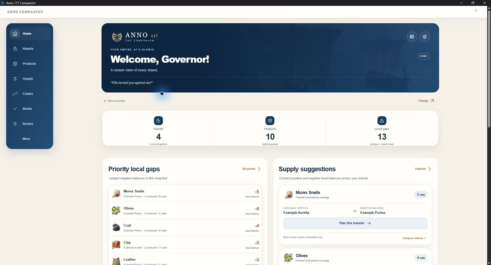

## 2. Supply by progression

**Windows EXE.** Expanded Plebeians group showing complete Coal, Bread and Olives transfer cards and planning actions.

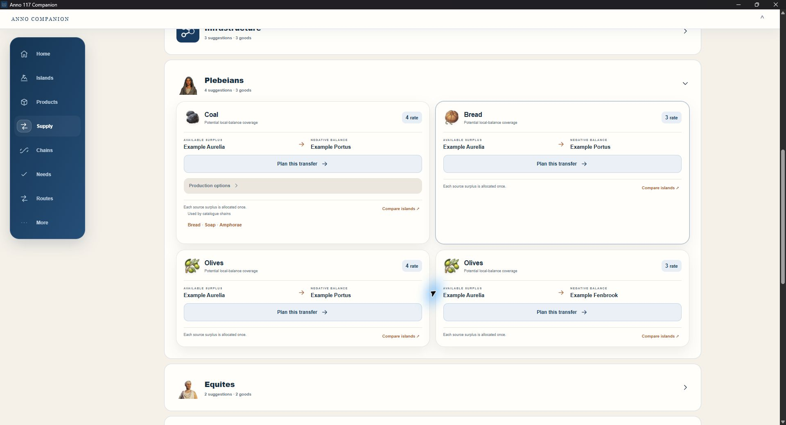

## 3. Production-chain calculator

**Windows EXE.** The Amphorae panel is scrolled to its core Resin, Clay and Potter steps, additional building counts, productivity and specialist links. Fuel and other sections remain available by scrolling.

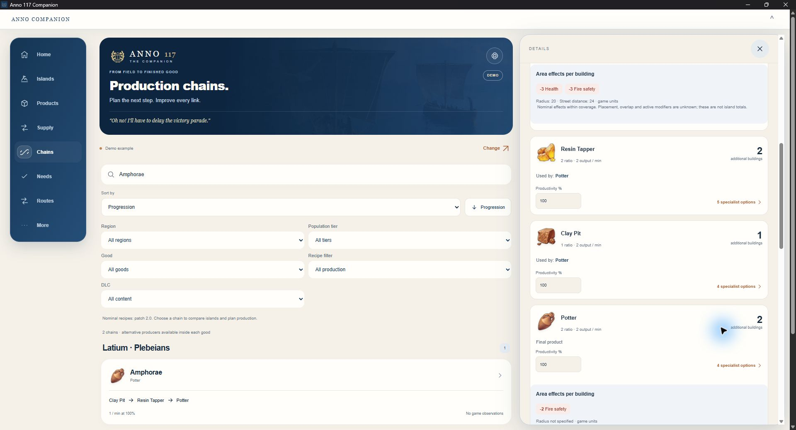

## 4. Tier needs

**Windows EXE.** Expanded Liberti Food category with rewards, local balance information and build/import/supply options. This does not claim measured residence or service fulfilment.

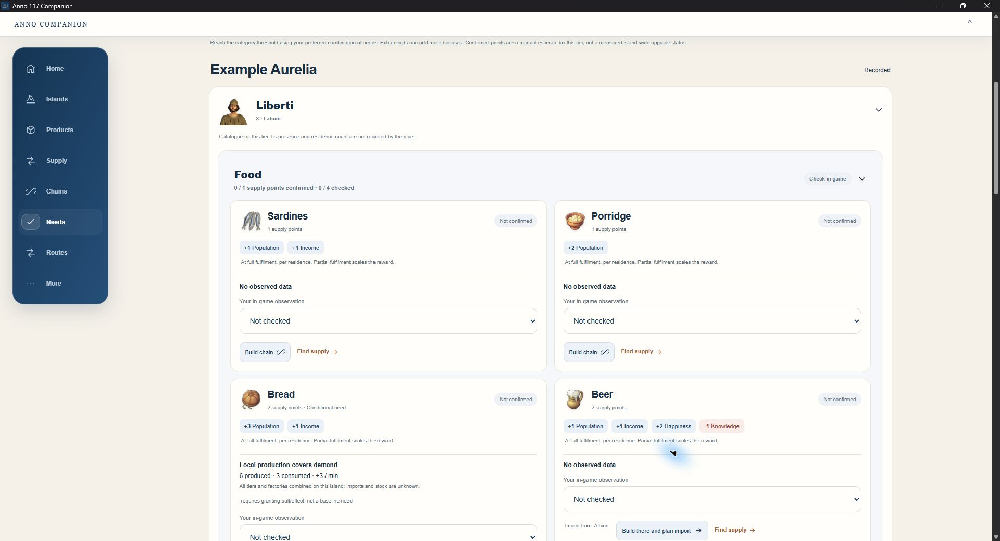

## 5. Multi-good route plans

**Local browser.** Two saved demo plans. Golden Coast Supply visits three Example islands, carries three goods and checks slot capacity on each leg. Cargo quantities are manual example values, not game telemetry.

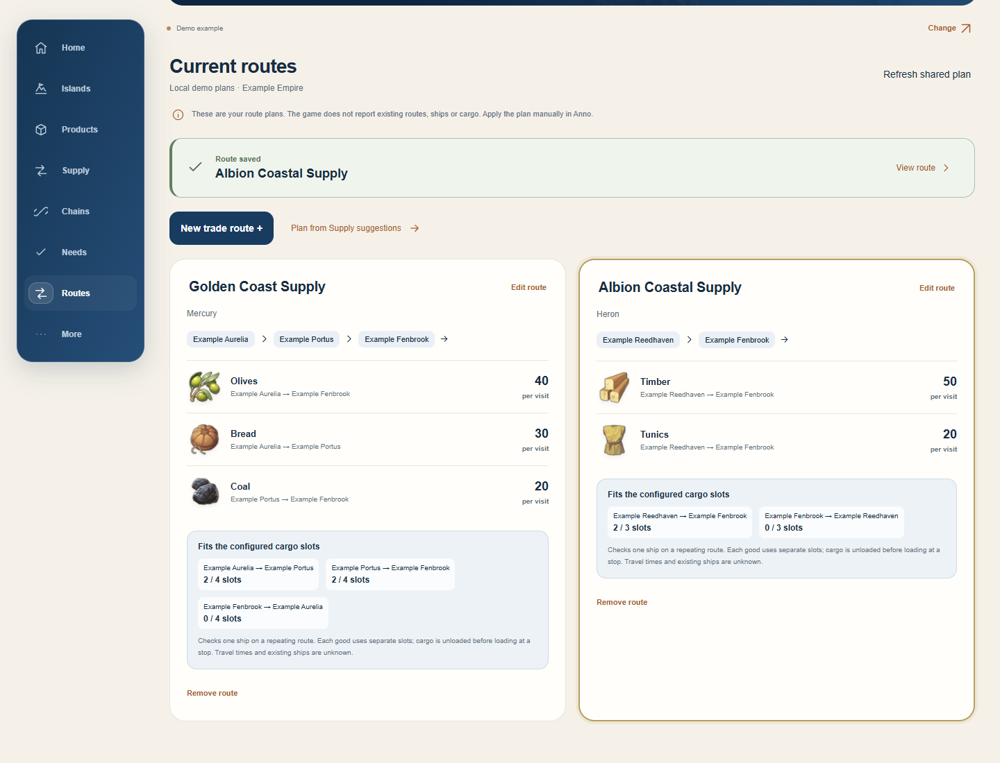

## 6. Region-aware production

**Local browser.** Olives demand on Example Fenbrook in Albion, with the complete Latium production-plus-import alternative and its action visible.

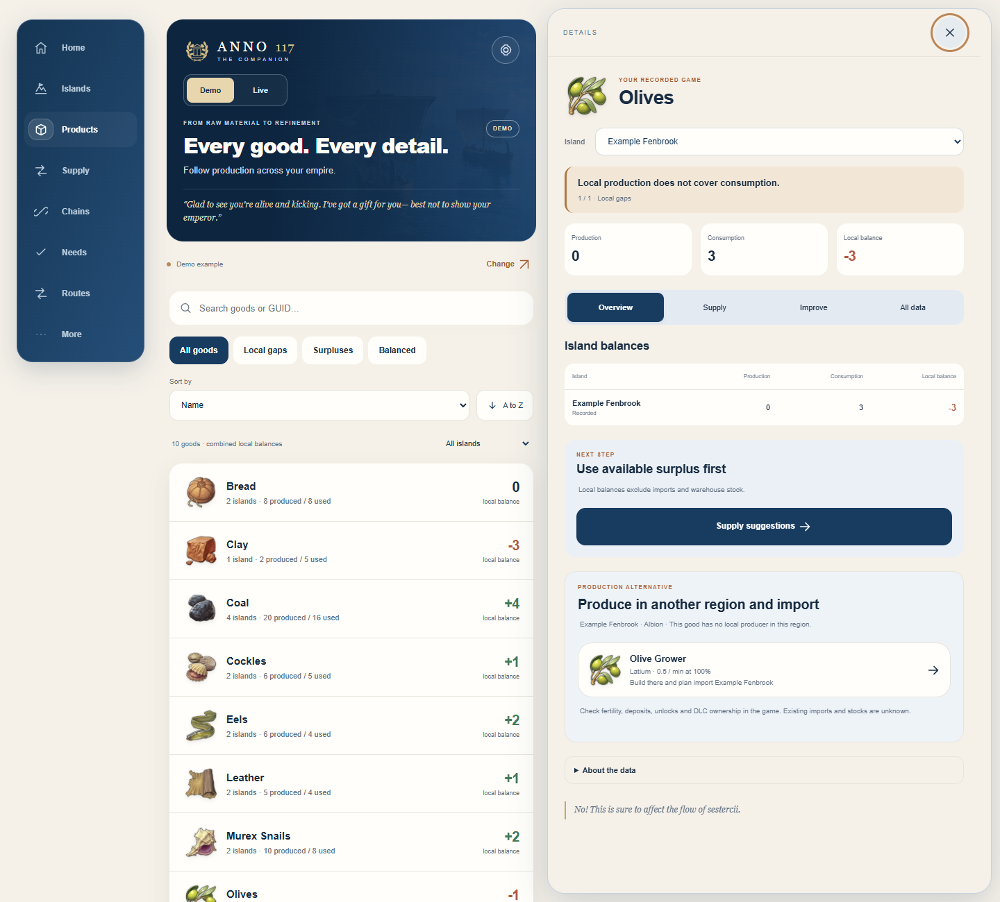

## 7. Android Supply

**Samsung / release APK.** Actual APK on the connected Samsung. Two complete transfer cards and their planning actions are visible.

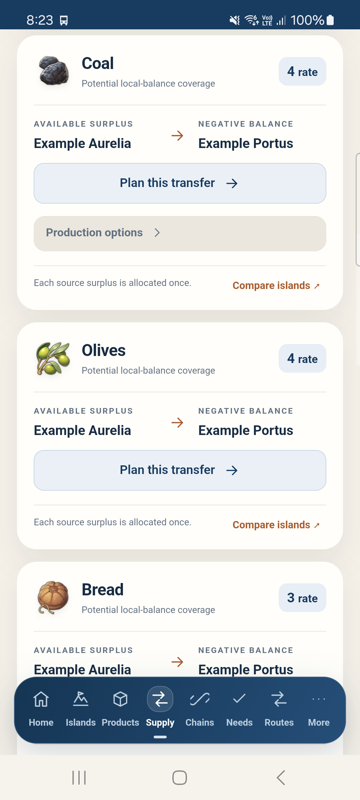

## 8. Android product details

**Samsung / release APK.** Actual Murex Snails detail: Example Portus, production 1, consumption 6 and local balance -5. Overview, Supply, Improve and All data tabs are visible.

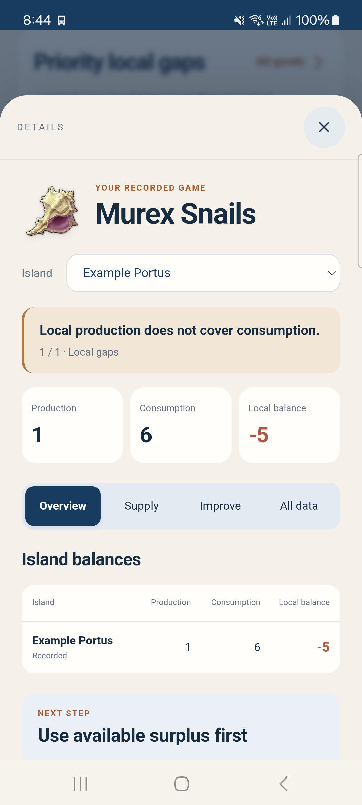

## 9. Home-screen widget

**Samsung launcher.** User-arranged clean Samsung launcher page without personal shortcuts. The widget shows the user's last received Live game values while the PC is unavailable; it is a cached-data example, not synthetic Demo or a currently live connection.

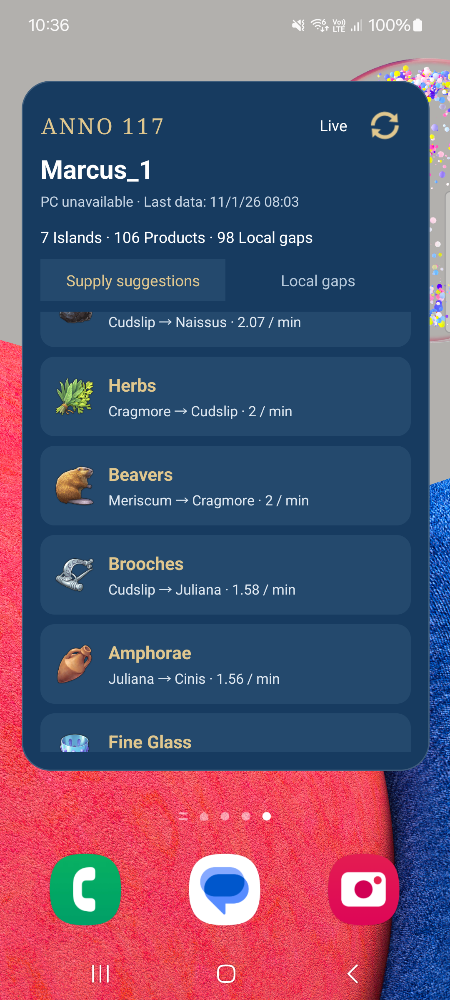

## 10. Illustrated empire report

**Exported PDF / page 1.** Rendered from the Companion export, including the four Example islands and region artwork.

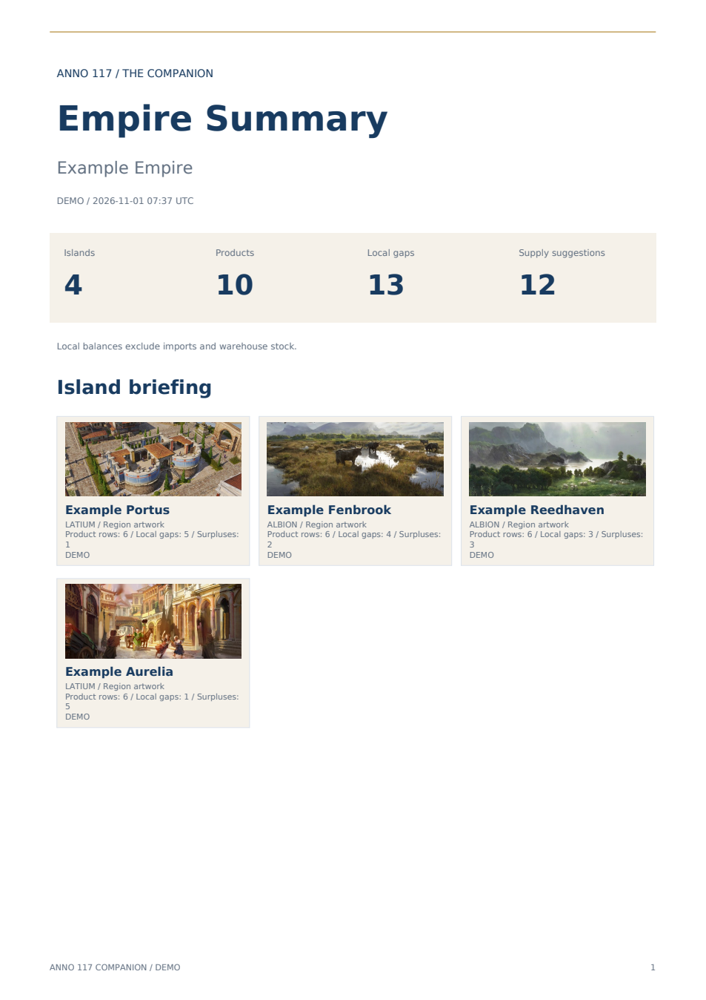

## 11. Report production icons

**Exported PDF / page 2.** Rendered from the same PDF. Product icons, island names, production, consumption and balances are visible.

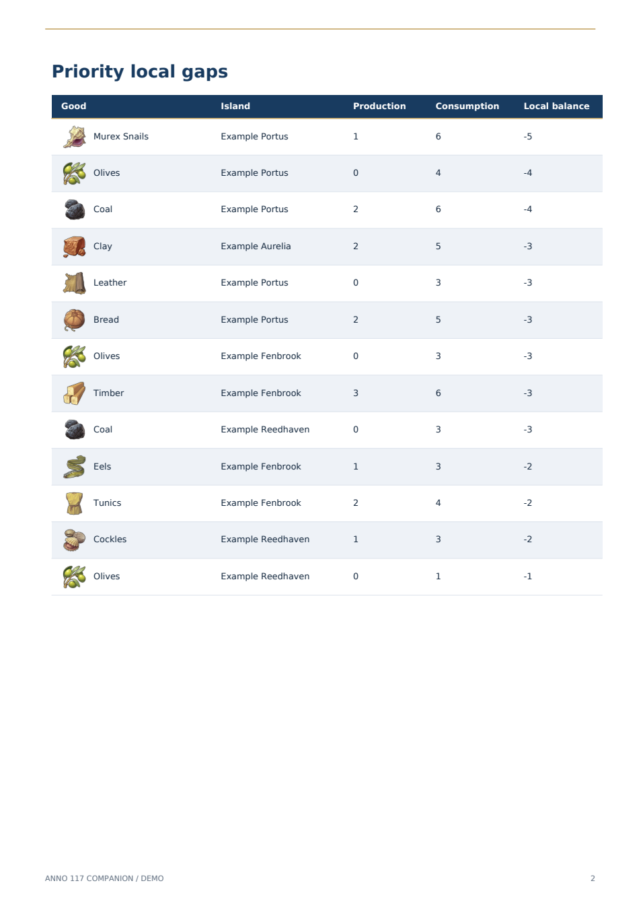

## 12–13. Observed production and import options (v0.20.2)

**Local browser, desktop and mobile viewport.** Synthetic Example Empire. Island cards show observed production, consumption, balance and freshness. Existing surplus can be planned directly; expansion and new construction remain separate actions. These are browser captures, not native Android screenshots.

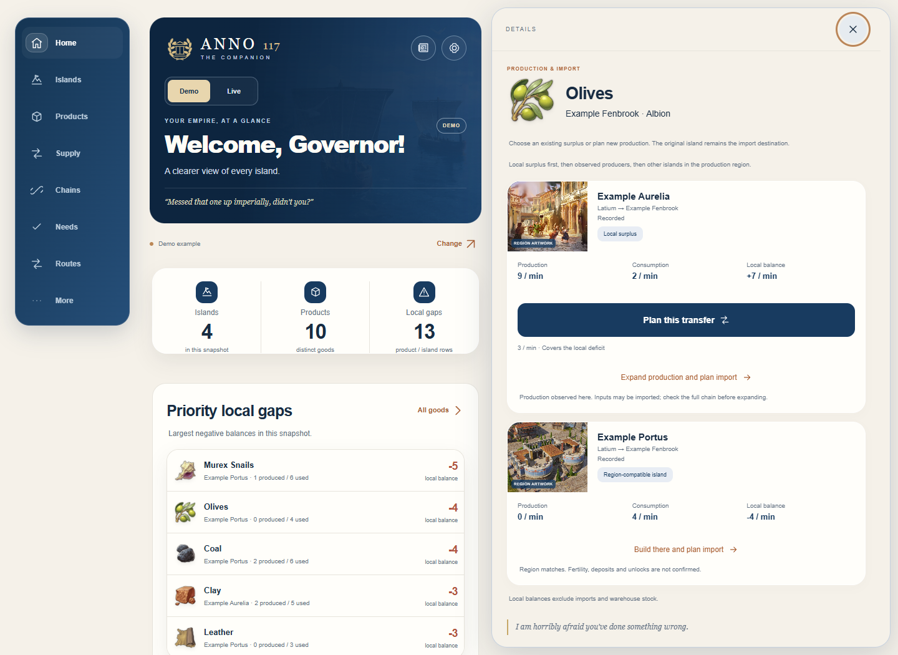

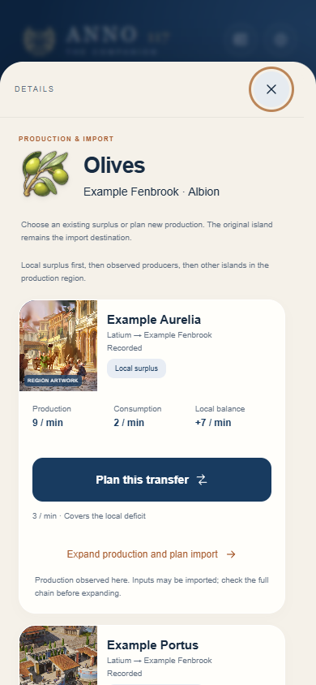
